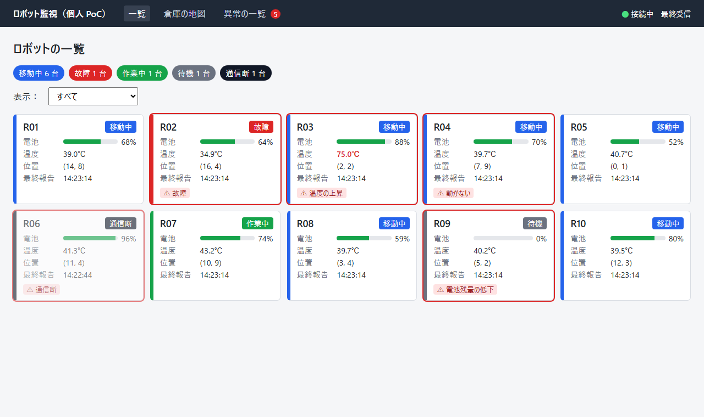
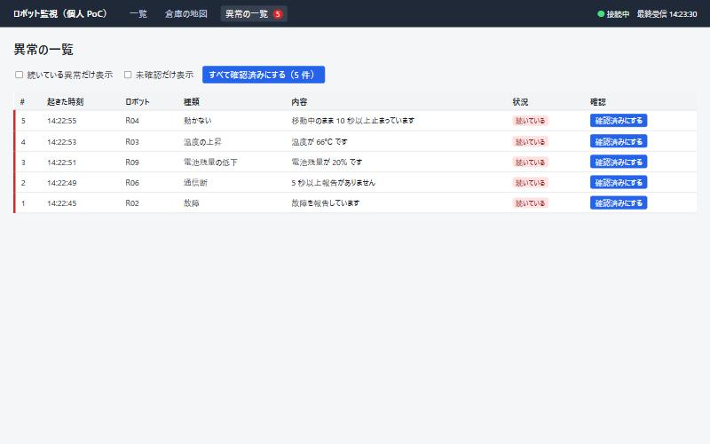
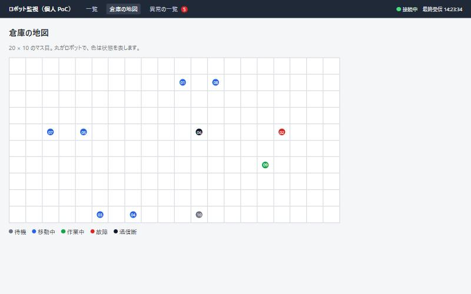
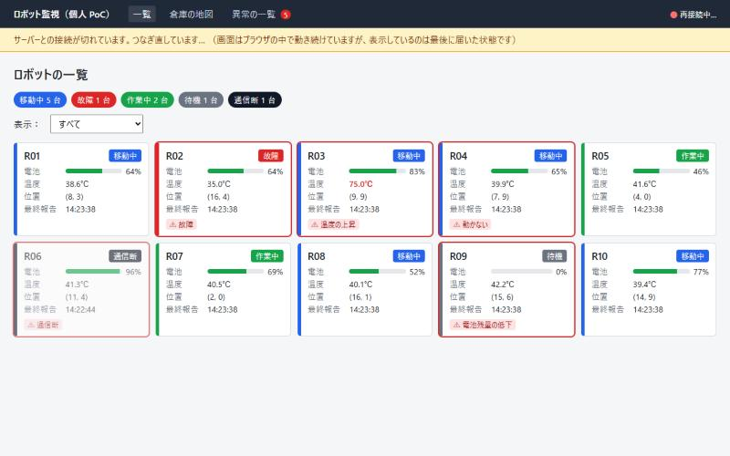
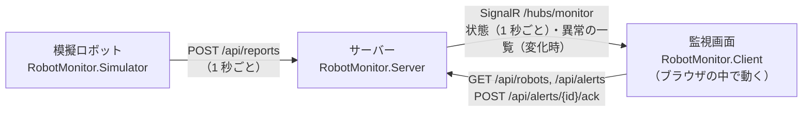

# ロボット監視画面 PoC（Blazor WebAssembly）

## 📚 このリポジトリの目的は「学習」です

## 🛠️ AI が作った最初の版を土台に、学習者（私）が自分の手で改修していきます

**C# で Web 画面を作る Blazor WebAssembly と、ブラウザの中で C# が動く WebAssembly の仕組みを、実際に動くものを改修しながら身につけるためのリポジトリです。**

| 段階 | 誰が | 内容 |
| --- | --- | --- |
| 1. 最初の版 | AI（Claude Code） | 動く最小構成を生成し、動作を確認した（2026-11-09） |
| 2. 改修 | **学習者（私）** | コードを読み、挙動を確かめ、機能の追加や直しを自分で行う |
| 3. 記録 | **学習者（私）** | 何を試し、何が分かり、どう直したかを [改修の記録](#改修の記録) と [docs/判断ログ.md](docs/判断ログ.md) に残す |

完成品や実務の実績ではなく、**学習のための個人 PoC** です。実機のロボットは使っておらず、ロボットも異常もプログラムで模擬しています。

---

## 画面

模擬のロボット 10 台が 1 秒ごとに状態を送り、サーバーが異常を判定して、画面にリアルタイムで表示します。

### ロボットの一覧

状態を色で表示し、異常があるロボットは赤枠と「⚠」で示します。



### 異常の一覧

いつ・どのロボットで・何が起きたかを表示します。1 件ずつ、またはまとめて「確認済み」にできます。



### 倉庫の地図

20×10 のマス目に、ロボットの位置を状態の色で表示します。



### サーバーとの接続が切れたとき

画面はブラウザの中で動き続け、最後に届いた状態を表示したまま、自動でつなぎ直します。



## 改修の記録

学習者（私）が行った改修を、ここに書き足していきます。

| 日付 | 改修したこと | 分かったこと |
| --- | --- | --- |
| 2026-11-09 | （最初の版。AI が生成） | |

## 構成



| プロジェクト | 内容 |
| --- | --- |
| `src/RobotMonitor.Shared` | 3 つで共通に使う型（ロボットの状態、報告、異常）と、異常の判定に使う値（`Thresholds.cs`） |
| `src/RobotMonitor.Simulator` | 模擬ロボット（コンソール）。コマンドで異常を起こせる |
| `src/RobotMonitor.Server` | ASP.NET Core。報告の受け取り、異常の判定、SignalR での送信、API。画面のファイルの配信も行う |
| `src/RobotMonitor.Client` | Blazor WebAssembly の画面。ブラウザにダウンロードされ、ブラウザの中で C# が動く |

### 主なファイル

| ファイル | 内容 |
| --- | --- |
| `Server/Monitoring/RobotStore.cs` | 最新の状態と異常の履歴を持ち、異常を判定する |
| `Server/Monitoring/RobotBroadcaster.cs` | 1 秒ごとに通信断を判定し、画面へ状態を送る |
| `Server/Program.cs` | API と SignalR の設定 |
| `Client/Services/MonitorClient.cs` | サーバーに SignalR でつなぎ、受け取った状態を持つ。切れたらつなぎ直す |
| `Client/Services/MonitorComponentBase.cs` | 状態が届いたら画面を描き直す、部品の共通の土台 |
| `Client/Pages/Home.razor` | ロボットの一覧 |
| `Client/Pages/Alerts.razor` | 異常の一覧（確認済みにする） |
| `Client/Pages/Map.razor` | 倉庫の地図 |
| `Client/Layout/MainLayout.razor` | 上部の帯（未確認の件数、接続の状態）と、切断時の表示 |
| `Server/Components/App.razor` | ページの外枠。WebAssembly で動かす指定（事前レンダリングなし）をしている |

## 動かし方

必要なもの：.NET 10 SDK

ターミナルを 2 つ開きます。

**1. サーバー**（http://localhost:5080 で起動し、ブラウザが開きます）

```bash
dotnet run --project src/RobotMonitor.Server --launch-profile http
```

**2. 模擬ロボット**

```bash
dotnet run --project src/RobotMonitor.Simulator
```

台数や間隔は変えられます（挙動確認の 4 用）。

```bash
dotnet run --project src/RobotMonitor.Simulator -- --count 100 --interval 500
```

### 模擬ロボットのコマンド

模擬ロボットのターミナルで入力して Enter を押します。`N` はロボットの番号（1〜10）か `all` です。

| コマンド | 起こること | 画面に出る異常 |
| --- | --- | --- |
| `d N` | 報告を送らない（もう一度で戻る） | 5 秒後に「通信断」 |
| `b N` | 電池が 1 秒に 5% 減る | 20% を下回ると「電池残量の低下」 |
| `h N` | 温度が上がり続ける | 60℃ 超えが 3 回続くと「温度の上昇」 |
| `s N` | 移動中のまま止まる | 10 秒後に「動かない」 |
| `f N` | 故障 | すぐに「故障」 |
| `r N` | 起こした異常をすべてやめて、正常の範囲に戻す | 異常が「正常に戻った」になる |
| `list` | 全台の状態を表示 | |
| `q` | 終了 | |

## 画面ごとの機能

| 画面 | 内容 |
| --- | --- |
| 一覧（`/`） | 10 台をカードで表示。状態を色で、異常があるものは赤枠で示す。状態で絞り込める |
| 倉庫の地図（`/map`） | 20×10 のマス目にロボットの位置を表示 |
| 異常の一覧（`/alerts`） | 起きた時刻・ロボット・種類・内容・正常に戻ったか。1 件ずつ、またはまとめて「確認済み」にできる |
| 上部の帯 | 未確認の異常の件数、サーバーとの接続の状態、最後に受け取った時刻 |

## 異常の判定

値は `src/RobotMonitor.Shared/Thresholds.cs` にあります。**仮の値**なので、試しながら見直してください。

| 異常 | 起きる条件 | 戻る条件 |
| --- | --- | --- |
| 通信断 | 最後の報告から 5 秒以上 | 再び報告が届いた |
| 電池残量の低下 | 20% 未満 | 25% 以上 |
| 温度の上昇 | 60℃ 超えが 3 回続いた | 55℃ 以下 |
| 動かない | 「移動中」で 10 秒以上位置が変わらない | 位置が変わった、または移動中でなくなった |
| 故障 | ロボットが「故障」を報告した | 故障以外を報告した |

「起きる値」と「戻る値」をずらしているのは、境目の値で異常が出たり消えたりを繰り返さないようにするためです。

## AI が行った動作確認（2026-11-09）

- 10 台の報告がサーバーに届き、画面に 1 秒ごとに反映された
- 5 種類の異常をコマンドで起こし、すべて判定された。`r all` ですべて「正常に戻った」になった
- 「確認済みにする」で、未確認の件数が減った
- サーバーを止めると、画面の上部に「接続が切れています」が出た。止めている間も画面の切り替えはできた（画面はブラウザの中で動いているため）
- サーバーを起動し直すと、数秒で自動的につなぎ直された

**実際に自分で操作して確かめるのは、これからです。**

### 確認中に気づいたこと

- サーバーを起動し直すと、異常の履歴が消える（メモリにだけ持っているため）。
- さらに、その時点で通信断だったロボットは、サーバーから見ると「存在しないロボット」になり、一覧から消える。本番の監視なら、監視する台数はサーバーの設定やデータベースで別に持つ必要がある。

## 挙動確認の項目（これから自分で試す）

Notion の検討ページで挙げた項目です。結果はこの README か docs に書き足していきます。

| # | 確かめること | 状態 |
| --- | --- | --- |
| 1 | 最初の読み込みの重さ（開発者ツールで量と時間を測る。2 回目と比べる） | 未 |
| 2 | サーバーが止まったときの画面 | AI が確認（上記）。自分では未 |
| 3 | Interactive Server 方式との違い | 未（Server 方式の画面はまだない） |
| 4 | 台数・間隔を増やしたときの重さ（`--count`, `--interval`） | 未 |
| 5 | 1 つのスレッドで動くことの制約 | 未 |
| 6 | JavaScript との連携（グラフなど） | 未 |
| 7 | ブラウザの中で動く C# のデバッグ | 未 |
| 8 | ダウンロードされたファイルからコードが読めること | 未 |

## まだ作っていないもの

- ロボットの詳細画面（電池・温度の移り変わりのグラフ）
- 稼働の集計
- 設定の配信（OTA の模擬）
- ログイン、データベースへの保存
